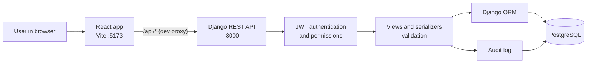
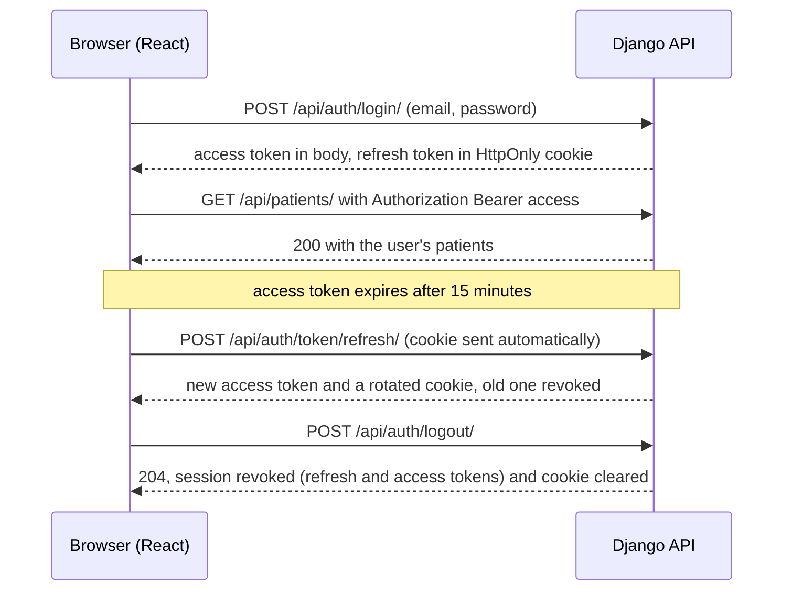
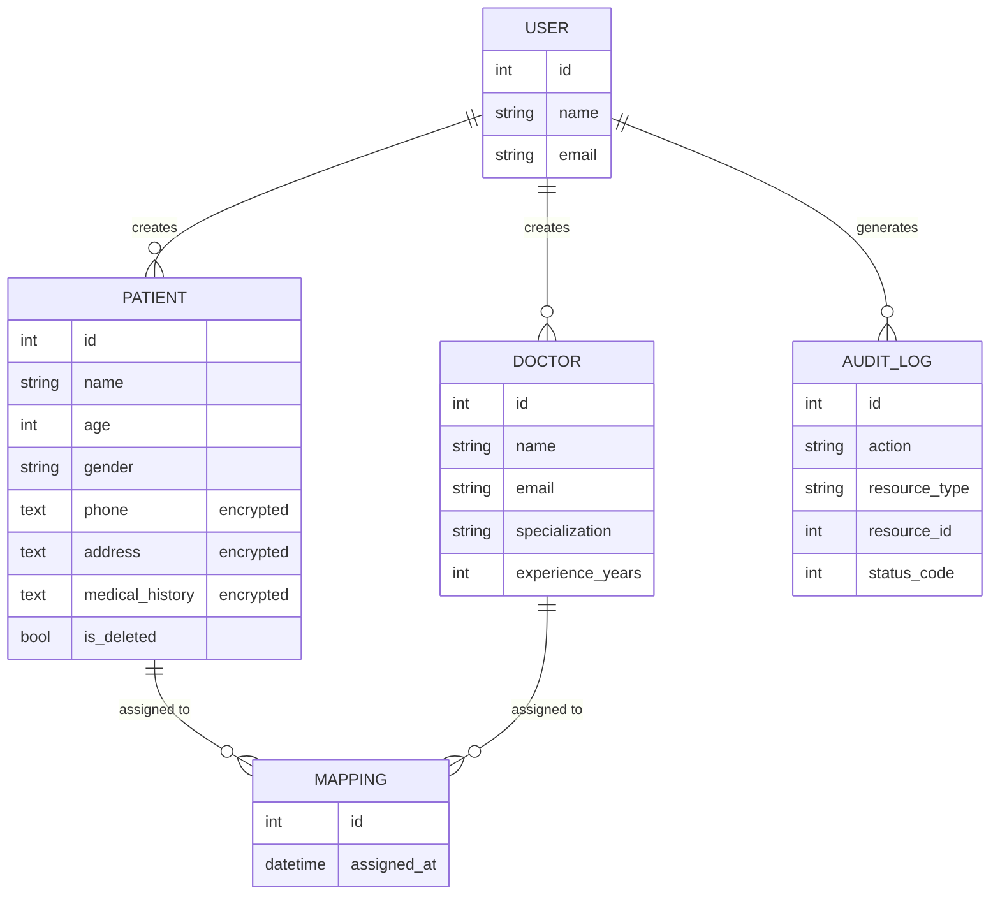

# 🏥 Healthcare Management System

A full-stack healthcare application where doctors and clinic staff can **register, log in securely, and manage patient and doctor records**, then **assign doctors to patients**.

- **Backend:** Django + Django REST Framework + PostgreSQL, secured with JWT
- **Frontend:** React (Vite) single-page app that consumes the API


---

## 📑 Table of Contents
1. [Demo Videos](#-demo-videos)
2. [Features](#-features)
3. [Tech Stack](#-tech-stack)
4. [How It Works](#-how-it-works)
5. [Repository Structure](#-repository-structure)
6. [Getting Started](#-getting-started)
7. [API Reference](#-api-reference)
8. [Testing](#-testing)
9. [Security](#-security)
10. [Environment Variables](#-environment-variables)
11. [Assignment Checklist](#-assignment-checklist)
12. [Known Limitations & Future Work](#-known-limitations--future-work)

---

## 🎥 Demo Videos

### 1️⃣ Backend demo: API testing with Postman

<!--
  HOW TO ADD YOUR VIDEO (pick ONE option):

  A) YouTube (recommended): upload the video (Unlisted is fine), copy the ID from the URL
     https://www.youtube.com/watch?v=THE_ID_IS_HERE  and replace YOUR_BACKEND_VIDEO_ID below.

  B) GitHub-hosted: edit this README on github.com, then drag & drop your .mp4 into the editor.
     GitHub uploads it and inserts a link that shows as an in-page video player (size limits apply).

  C) Google Drive / Loom: replace the link target with your share URL.
-->

[![Backend demo video]](https://drive.google.com/file/d/1LLbFeSfaWnoUeFiw6meFqud2mSFScNoS/view?usp=sharing)

**What this video shows**
- Registering and logging in, and receiving the JWT
- Creating, listing, updating and deleting patients and doctors
- Assigning doctors to patients and retrieving a patient's doctors
- Validation errors, unauthorized access (401), and one user being blocked from another user's data (404)
- Rate limiting, and logout with the old token being rejected immediately

> 📦 The Postman collection used in the video is in [`healthcare_backend/postman/`](healthcare_backend/postman/). Import it and click **Run**: 49 requests and 86 automatic tests.

### 2️⃣ Frontend demo: the web application

[![Frontend demo video]](https://drive.google.com/file/d/1slEhsAUYsGnRZLm_iuUpchDLTGlY_EJE/view?usp=sharing)

**What this video shows**
- Creating an account and logging in
- Adding, editing and deleting patients and doctors
- Assigning a doctor to a patient from the Mappings page and from a patient's detail page
- The **Live API calls** panel showing every request the UI makes to the backend, with its status code
- Staying logged in after a page refresh, then logging out

---

## ✨ Features

| Area | What you can do |
|---|---|
| **Accounts** | Register with name, email and password. Log in and get a JWT. Refresh the session silently. Log out. |
| **Patients** | Add, view, update and delete patients. Each user sees only their own patients. |
| **Doctors** | Add, view, update and delete doctors in your own directory. |
| **Mappings** | Assign doctors to patients, list all assignments, see a patient's doctors, remove an assignment. |
| **Security** | JWT auth, rate limiting, encrypted patient data, audit log, per-user data isolation. See [Security](#-security). |
| **Validation** | Clear error messages for bad input (age range, duplicate emails, weak passwords, etc.). |

---

## 🧰 Tech Stack

| Layer | Technology |
|---|---|
| Backend framework | Django 5, Django REST Framework |
| Authentication | JWT via `djangorestframework-simplejwt` (with token rotation and blacklist) |
| Database | PostgreSQL (Django ORM) |
| Encryption | `cryptography` (Fernet) for sensitive patient fields |
| Frontend | React 18, React Router, Vite |
| Config | Environment variables (`python-dotenv`) |

---

## ⚙️ How It Works

### Architecture



### Login and session flow



### Data model



### Key rules
- **Data isolation:** every patient, doctor and mapping belongs to the user who created it. Other users get `404`, so they cannot even tell a record exists.
- **Soft delete:** deleting a patient hides it from the API but keeps the row in the database for audit purposes.
- **Safe deletes:** a doctor who is still assigned to a patient cannot be deleted (`409`).
- **Unique assignments:** the same doctor cannot be assigned to the same patient twice.

---

## 📁 Repository Structure

```
Healthcare/
├── healthcare_backend/              Django REST API
│   ├── config/                      settings, root URLs
│   ├── accounts/                    custom user, register, login, refresh, logout
│   ├── patients/                    patient model, serializers, views
│   ├── doctors/                     doctor model, serializers, views
│   ├── mappings/                    patient-doctor assignments
│   ├── audit/                       append-only audit log
│   ├── core/                        encrypted field, throttles, pagination, error handling
│   ├── postman/                     Postman collection for the demo
│   ├── requirements.txt
│   └── .env.example
├── healthcare_frontend/             React single-page app
│   ├── src/
│   │   ├── api.js                   API client (token handling, auto-refresh)
│   │   ├── auth.jsx                 login state
│   │   ├── pages/                   Login, Register, Patients, PatientDetail, Doctors, Mappings
│   │   └── components/              Layout, Notice, Pager, Live API calls panel
│   ├── vite.config.js               dev proxy to the backend
│   └── .env.example
└── README.md
```

---

## 🚀 Getting Started

### Prerequisites
- Python 3.10+
- Node.js 18+
- PostgreSQL

### 1. Clone

```bash
git clone <your-repo-url>
cd Healthcare
```

### 2. Backend

```bash
cd healthcare_backend

python -m venv venv
source venv/bin/activate          # Windows: venv\Scripts\activate
pip install -r requirements.txt

cp .env.example .env              # Windows: copy .env.example .env
```

Generate the two secrets and put them in `.env`:

```bash
# SECRET_KEY
python -c "from django.core.management.utils import get_random_secret_key as g; print(g())"

# FIELD_ENCRYPTION_KEYS (encrypts patient data; back this up, losing it loses the data)
python -c "from cryptography.fernet import Fernet; print(Fernet.generate_key().decode())"
```

Also set your PostgreSQL credentials (`DB_NAME`, `DB_USER`, `DB_PASSWORD`, `DB_HOST`, `DB_PORT`), then create the database and start the server:

```bash
psql -U postgres -c "CREATE DATABASE healthcare_db;"

python manage.py migrate
python manage.py runserver        # http://127.0.0.1:8000
```

Optional: create an admin for the Django admin site (`/admin/`):

```bash
python manage.py createsuperuser
```

### 3. Frontend

Open a second terminal:

```bash
cd healthcare_frontend
npm install
cp .env.example .env              # defaults work with the backend on port 8000
npm run dev                       # http://localhost:5173
```

Open **http://localhost:5173**, register an account, and log in.

> 💡 In development the frontend calls `/api/...` on its own address and Vite forwards it to Django. This keeps the login cookie working without any CORS setup. In production, serve the frontend and API under the same domain.

---

## 📡 API Reference

Base URL: `http://127.0.0.1:8000/api`

Protected endpoints need the header `Authorization: Bearer <access_token>`. List endpoints are paginated: `?page=2&page_size=20` (max 100) and return `{ count, next, previous, results }`.

### Authentication

| Method | Endpoint | Auth | Description |
|---|---|---|---|
| POST | `/auth/register/` | No | Register with `name`, `email`, `password` |
| POST | `/auth/login/` | No | Log in. Returns `access` token. Refresh token is set as an HttpOnly cookie |
| POST | `/auth/token/refresh/` | Cookie | Get a new access token (the refresh token rotates) |
| POST | `/auth/logout/` | Cookie | Revoke the refresh token and clear the cookie |

### Patients

| Method | Endpoint | Description |
|---|---|---|
| POST | `/patients/` | Add a patient |
| GET | `/patients/` | List the logged-in user's patients |
| GET | `/patients/<id>/` | Get one patient |
| PUT | `/patients/<id>/` | Update a patient |
| DELETE | `/patients/<id>/` | Delete a patient (soft delete) |

### Doctors

| Method | Endpoint | Description |
|---|---|---|
| POST | `/doctors/` | Add a doctor |
| GET | `/doctors/` | List your doctors |
| GET | `/doctors/<id>/` | Get one doctor |
| PUT | `/doctors/<id>/` | Update a doctor |
| DELETE | `/doctors/<id>/` | Delete a doctor (blocked while assigned to a patient) |

### Patient-Doctor Mappings

| Method | Endpoint | Description |
|---|---|---|
| POST | `/mappings/` | Assign a doctor to a patient |
| GET | `/mappings/` | List all mappings |
| GET | `/mappings/<patient_id>/` | All doctors assigned to a patient |
| DELETE | `/mappings/<mapping_id>/` | Remove a doctor from a patient |

### Example requests

<details>
<summary><b>Register and log in</b></summary>

```http
POST /api/auth/register/
{ "name": "Asha Verma", "email": "asha@example.com", "password": "Str0ng!Pass99" }
```
```http
POST /api/auth/login/
{ "email": "asha@example.com", "password": "Str0ng!Pass99" }
```
```json
{ "user": { "id": 1, "name": "Asha Verma", "email": "asha@example.com" }, "access": "eyJhbGciOi..." }
```
</details>

<details>
<summary><b>Create a patient</b></summary>

```http
POST /api/patients/
Authorization: Bearer <access_token>

{
  "name": "Ravi Kumar",
  "age": 42,
  "gender": "M",
  "phone": "9999999999",
  "address": "12 MG Road, Pune",
  "medical_history": "Type 2 diabetes"
}
```
</details>

<details>
<summary><b>Create a doctor and assign them to the patient</b></summary>

```http
POST /api/doctors/
{ "name": "Meera Shah", "email": "meera.shah@hospital.com", "phone": "8888888888",
  "specialization": "Cardiology", "experience_years": 10 }
```
```http
POST /api/mappings/
{ "patient": 1, "doctor": 1 }
```
</details>

### Common error responses

| Situation | Status |
|---|---|
| Missing or invalid token | `401` |
| Invalid input (e.g. age above 150, weak password) | `400` |
| Record belongs to another user, or does not exist | `404` |
| Deleting a doctor who is still assigned | `409` |
| Too many login attempts | `429` |

---

## 🧪 Testing

### Automated backend tests

```bash
cd healthcare_backend
python manage.py test
```

Covers registration and login, token rotation and logout, rate limiting, ownership rules, encryption, soft delete, pagination and the audit log.

### Postman

1. Start the backend.
2. In Postman choose **Import** and select `healthcare_backend/postman/Healthcare_API.postman_collection.json`.
3. Click **Run** on the collection. Tokens and IDs are saved automatically between requests.

Or from the command line:

```bash
npx newman run healthcare_backend/postman/Healthcare_API.postman_collection.json
```

> Registration is limited to 5 per hour per IP. To run the collection again straight away, restart `runserver` to reset the counters.

---

## 🔐 Security

| Concern | How it's handled |
|---|---|
| **Authentication** | JWT (`simplejwt`). Access tokens last 15 minutes. |
| **Token storage** | Access token is kept in memory only. Refresh token is an `HttpOnly`, `SameSite=Strict` cookie that JavaScript can't read, so XSS can't steal it. |
| **Session revocation** | Refresh tokens rotate on every use. On logout the refresh token is blacklisted **and the session's access tokens are revoked immediately** (other devices stay logged in). |
| **Brute force** | Login limited per IP and per email, plus limits on registration and refresh. Responses give a generic "Invalid email or password". |
| **Authorization** | Users can only read and change their own patients, doctors and mappings. |
| **Data at rest** | Patient phone, address and medical history are encrypted in the database. |
| **Audit trail** | Every access and change to patient data, and every login, is recorded (who, what, when, IP). |
| **Safe deletion** | Soft delete for patients. Foreign keys use `PROTECT`. |
| **Passwords** | Hashed by Django, with strength validation on registration. |
| **Secrets** | All configuration comes from environment variables. `.env` is git-ignored. |
| **Production mode** | With `DEBUG=False`: HTTPS redirect, HSTS and secure cookies are enabled. |

> ⚠️ The Django admin (`/admin/`) can see all users' data. Only create superusers for people you trust, and restrict or disable the admin in production.

---

## 🔧 Environment Variables

Backend (`healthcare_backend/.env`, see `.env.example`):

| Variable | Description |
|---|---|
| `SECRET_KEY` | Django secret key (required) |
| `FIELD_ENCRYPTION_KEYS` | Fernet key(s) for encrypting patient data (required) |
| `DEBUG` | `True` for local development |
| `ALLOWED_HOSTS` | Comma-separated hosts |
| `DB_NAME`, `DB_USER`, `DB_PASSWORD`, `DB_HOST`, `DB_PORT` | PostgreSQL connection |
| `ACCESS_TOKEN_MINUTES`, `REFRESH_TOKEN_DAYS` | Token lifetimes |
| `CORS_ALLOWED_ORIGINS` | Frontend URL(s) allowed to call the API |
| `NUM_PROXIES` | Number of reverse proxies in front of Django (for rate limiting) |
| `REDIS_URL` | Optional shared cache so rate limits work across several workers |

Frontend (`healthcare_frontend/.env`):

| Variable | Description |
|---|---|
| `VITE_API_URL` | API base path (default `/api`) |
| `VITE_PROXY_TARGET` | Where the dev proxy forwards to (default `http://127.0.0.1:8000`) |

---

## ✅ Assignment Checklist

| Requirement | Status |
|---|---|
| Django + Django REST Framework | ✅ |
| PostgreSQL database | ✅ |
| JWT authentication with `djangorestframework-simplejwt` | ✅ |
| RESTful endpoints for patients and doctors | ✅ |
| Patient-doctor mapping APIs | ✅ |
| Django ORM models | ✅ |
| Error handling and validation | ✅ |
| Environment variables for sensitive configuration | ✅ |
| Authenticated-only access to patient/doctor/mapping endpoints | ✅ |
| Tested with Postman | ✅ collection included |

---

## 🛣️ Known Limitations & Future Work

- No email verification or password reset yet (needs an email provider).
- No multi-factor authentication.
- Ideas: appointment scheduling, role-based access (admin / doctor / nurse), search and filters, Docker setup, CI pipeline.

---

## 👤 Author

**Manas Madan**: [GitHub](https://github.com/2023UCA1802) · [LinkedIn](https://www.linkedin.com/in/manas-madan-803a1328a/)